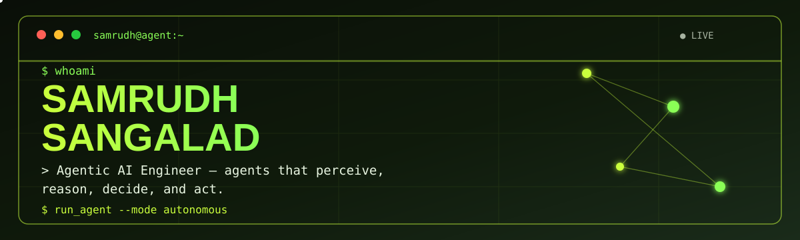
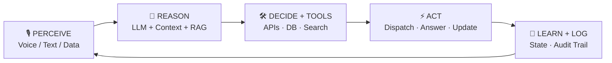
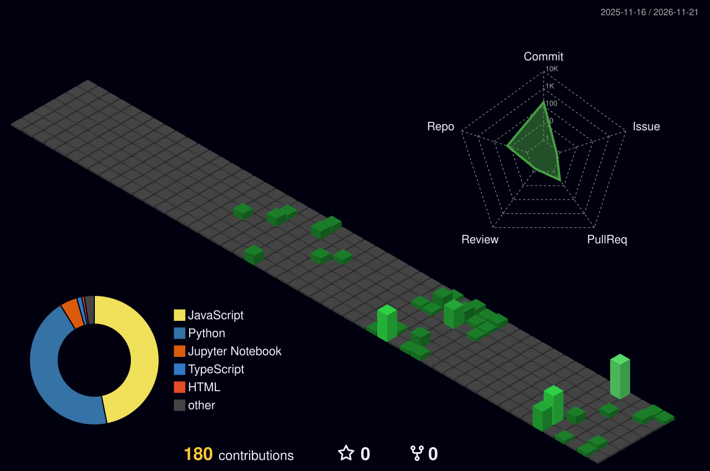

<!--
  SAMRUDH SANGALAD — GitHub Profile README — VERSION B: Dark Neon Agent Console
  Repo: SamrudhSS/SamrudhSS  (name MUST match the username exactly)
  Files: README.md + assets/banner.svg + .github/workflows/profile-3d-contrib.yml
  3D city: profile-night-green.svg (dark) / profile-green-animate.svg (light), no snake
  Palette: #0A0F08 bg / #CAFF3C lime accent / #8AFF57 secondary / #E8F5E1 text
  Type: Fira Code / JetBrains Mono for terminal + typing, GitHub native for body
  The clean version is kept as README-A-clean-editorial.md in this folder.
-->

<!-- ══════════ NEON CONSOLE BANNER — animated SVG ══════════ -->


<!-- ══════════ TYPING EFFECT — Fira Code, lime ══════════ -->
<p align="center">
  <a href="https://github.com/SamrudhSS">
    
  </a>
</p>

<p align="center">
  <a href="https://www.linkedin.com/in/samrudh-sangalad-67b283291/"></a>
  
  
  
  
</p>

<!-- ══════════ TERMINAL IDENTITY ══════════ -->

```bash
$ whoami
> Samrudh Sangalad — Agentic AI Engineer

$ cat .profile
ROLE:     Agentic AI / AIML Engineer
DOMAIN:   LLM systems · RAG · Voice agents · Data pipelines
STACK:    Python · FastAPI · LangChain · SQL · Twilio · Deepgram
COLLEGE:  B.E. AIML, Jain College of Engineering and Technology, Hubli
GRAD:     June 2027 · GPA 8.57 / 10
OPEN_TO:  AI / ML internships · Agentic AI roles
```

> **I don't build chatbots. I build agents that perceive, reason, decide — and act in the real world.**

---

## ⚡ `> cat agent-loop.yaml`



**My defaults when I build an agent:**

1. **Real input, real output** — a call, a document, an invoice. Not a toy dataset.
2. **Stateful, not stateless** — the agent remembers where it is in the task.
3. **Tools over talk** — if it can't call an API, query a DB, or trigger an action, it's not finished.
4. **Measured** — latency, accuracy, and failure paths matter. Savior targets sub-2-second transcription.
5. **Multilingual from day one** — English, Hindi, Kannada, Hinglish.

---

## 🚀 `$ ls /projects --flagship`

<details open>
<summary><b>1 · Savior — Automatic Emergency Dispatch Agent</b></summary>

**Problem:** an emergency call is chaos. Someone has to understand it fast — and send help to the right place, right now.

**What it does:** automatically identifies the incident from an emergency call and dispatches it to the right station / response team.

|  |  |
| --- | --- |
| **Stack** | Twilio Voice · Deepgram Speech-to-Text · FastAPI · WebSockets · React · Bolna AI Agent |
| **Scale** | Real-time voice → understanding → dispatch, sub-2-second transcription latency |
| **Impact** | Agentic AI with consequences — not a Q&A demo |

[](https://github.com/SamrudhSS/savior)
[](https://github.com/SamrudhSS/Saviory)
</details>

<details>
<summary><b>2 · SabhaIntel — Search Parliament by Meaning, Not Keywords</b></summary>

**Problem:** parliamentary discussions are vast and in two languages. Keyword search fails — you have to already know the exact words.

**What it does:** ask in plain language, in two languages, and it finds the discussion by its meaning.

|  |  |
| --- | --- |
| **Stack** | FastAPI · NLP / LLMs · Embeddings / Vector Search · Semantic Search · JavaScript |
| **Scale** | 10,000+ parliamentary documents |

[](https://github.com/SamrudhSS/SabhaIntel)
</details>

<details>
<summary><b>3 · InvoiceIQ — Invoice Intelligence at Enterprise Volume</b></summary>

**Problem:** large enterprises process high volumes of vendor invoices every day. Manual processing doesn't scale.

**What it does:** ETL + structured processing that turns messy invoice data into clean, queryable records.

|  |  |
| --- | --- |
| **Stack** | Python · PySpark ETL · MySQL / SQL |

[](https://github.com/SamrudhSS/invoiceIQ)
</details>

<details>
<summary><b>4 · VoxFin — Multilingual Financial Conversation Intelligence</b></summary>

**Problem:** financial discussions in India don't happen in clean English. They happen in Hinglish, Kannada-English, and informal speech — and the insight gets lost.

**What it does:** passively detects, transcribes, and structures informal financial discussions in Indian languages into actionable insights.

**Built for:** Hack2Future 2.0

[](https://github.com/SamrudhSS/VoxFin)
</details>

---

## 🧩 `$ ls /projects --also-building`

| Repo |  |
| --- | --- |
| [crowdwisdom-sentiment-pipeline](https://github.com/SamrudhSS/crowdwisdom-sentiment-pipeline) | Python · sentiment pipeline |
| [realtor](https://github.com/SamrudhSS/realtor) | Python |
| [property\_management](https://github.com/SamrudhSS/property_management) | JavaScript |
| [offline\_counsel](https://github.com/SamrudhSS/offline_counsel) | Counselling, offline-first |
| [yuvaintern](https://github.com/SamrudhSS/yuvaintern) | Jupyter Notebook · most recently active |
| [ksp-crime-analytics-platform](https://github.com/SamrudhSS/ksp-crime-analytics-platform) | JavaScript · crime analytics — fork, contributed |
| [Sentinel4](https://github.com/SamrudhSS/Sentinel4) · [AgriNivesh](https://github.com/SamrudhSS/AgriNivesh) · [ghostmorpheus](https://github.com/SamrudhSS/ghostmorpheus) | JavaScript builds |
| [obsidian\_wild](https://github.com/SamrudhSS/obsidian_wild) | HTML |

---

## 🛠️ `$ cat stack.yaml`

<p align="center">
  
</p>

**AI / Agents:** NLP · LLMs · RAG · Embeddings / Vector Search · Speech-to-Text · Agentic Workflows
**Backend / Data:** FastAPI · Django · Streamlit · PySpark · MySQL
**Voice / Real-time:** Twilio Voice · Deepgram · WebSockets · Bolna AI
**Languages:** Python · JavaScript · SQL

---

## 📊 `$ ./stats --live`

<p align="center">
  
  
</p>

<p align="center">
  
</p>

<p align="center">
  
</p>

<!-- 3D contribution city — generated by .github/workflows/profile-3d-contrib.yml, updates daily -->
<!-- Night-green is the dark-mode city. It is green, not exact lime #CAFF3C — that is the closest built-in theme. -->
<p align="center">
  <picture>
    <source media="(prefers-color-scheme: dark)" srcset="https://raw.githubusercontent.com/SamrudhSS/SamrudhSS/output-3d-contrib/profile-night-green.svg" />
    <source media="(prefers-color-scheme: light)" srcset="https://raw.githubusercontent.com/SamrudhSS/SamrudhSS/output-3d-contrib/profile-green-animate.svg" />
    
  </picture>
</p>

<p align="center"><i>178 contributions in the last year — verified on the live profile, 14 Nov 2026.</i></p>

---

## 🎯 `$ cat looking-for.txt`

- **AI / ML internships and entry-level AI engineering roles** — especially agentic AI, LLM systems, and RAG.
- Teams where I can **ship a real agent**, not just tune a notebook.
- Bengaluru / Hubli / hybrid / remote.

## 📫 `$ ./connect`

- 💼 LinkedIn: [Samrudh Sangalad](https://www.linkedin.com/in/samrudh-sangalad-67b283291/)
- ✉️ Email: samrudh3690@gmail.com <!-- ← replace this placeholder with your real email -->
- 🧑‍💻 GitHub: [@SamrudhSS](https://github.com/SamrudhSS)

<p align="center">
  <b>“Give me a messy real-world problem, a voice call, or 10,000 documents —<br/>I'll build the agent that makes sense of it.”</b>
</p>

<p align="center">
  
</p>